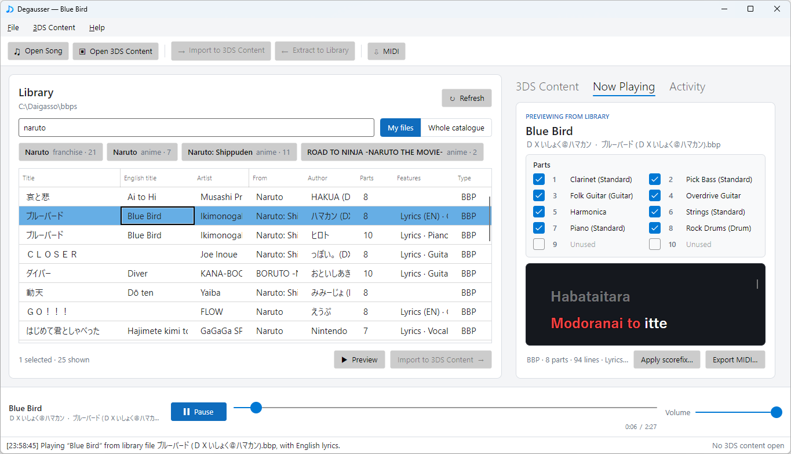

# Degausser 3.0

A song manager, player and converter for **Daigasso! Band Brothers P** on the Nintendo 3DS.

Keep a library of your songs on your computer, listen to them with the game's karaoke, move them in and out of your 3DS save data, and bring over songs from the DS game, **Band Brothers DX**.



## What you can do

- **Manage your 3DS save.** Open your Band Brothers P save data and see its songs, movies and Vocaloids. Import songs from your library, extract them back out, or delete them.
- **Build a song library.** Point Degausser at a folder of `.bbp`, `.bdx`, `.bbpm` and `.bbpv` files and browse, search and sort them.
- **Listen.** Play any song with a SoundFont, mute individual parts, seek, and follow the lyrics with the game's own karaoke sweep.
- **Convert Band Brothers DX songs.** Drop a `.bdx` into your library or save and it becomes a Band Brothers P song.
- **Export MIDI** of the song you're listening to.
- **Search the whole official catalogue.** The 7,952 songs and 9,722 arrangements of the BBP Catalogue are built in: find a song by title, artist, game, anime or franchise, in English or Japanese, see which ones you already have, and import a whole collection in one go.
- **Movies and Vocaloids.** Export and import downloadable movies and singers as portable `.bbpm` and `.bbpv` packages, with English titles if you like.
- **English titles and romaji lyrics.** The [scorefixes](scorefixes/) give songs English titles, so they sort under the right letter on the console, and romaji lyrics timed to the game's karaoke.

## Get it

Download the zip for your system from the [Releases](../../releases) page, unzip it, and run `Degausser`:

| System | Download |
|---|---|
| Windows (64-bit) | `Degausser-3.0.0-win-x64.zip` |
| Linux (64-bit) | `Degausser-3.0.0-linux-x64.zip` |
| macOS (Apple silicon) | `Degausser-3.0.0-osx-arm64.zip` |

Each zip holds the program, a `scorefixes` folder (keep those two together), and the licence files, and doesn't need .NET installed. The macOS build isn't signed, so the first time, right-click it and choose Open. Other systems can build from source (below).

## First steps

1. **Choose a SoundFont** so songs can be played: **Settings → Get BBP.sf2** opens the download page for the SoundFont made for these songs. Save it, then pick it with Browse. Windows and macOS fall back to the system synthesiser without one.
2. **Pick a library folder** with your song files (**Settings → Library folder**).
3. **Open your save** with **File → Open 3DS Content…** and choose the save data folder, the one that contains `jb`, `mv` and `singer` (see [Where your save data is](#where-your-save-data-is)). Take a copy of it first.
4. English titles and lyrics work out of the box while the `scorefixes` folder sits next to the program. To use a different folder, set it in **Settings → Scorefixes**.

Degausser doesn't come with any songs. Settings are only remembered if you tick **Keep these settings between sessions**.

### Where your save data is

- **With the English translation patch**, the game keeps its save on the SD card as ordinary files. Put the card in your computer and open its `P` folder.
- **Without the patch**, the save is in the console's encrypted extdata. Use a save manager on the 3DS, such as [Checkpoint](https://github.com/BernardoGiordano/Checkpoint) or JKSM, to back up the game's extdata to the SD card. Open that backup in Degausser, then restore it to the console with the same tool when you're done. (Degausser3DS, in [3ds/](3ds/Degausser3DS/), edits extdata on the console itself, but does far less.)

## Common tasks

**Add songs to your save**
1. Open your save (it appears in the **3DS Content** tab on the right).
2. Select one or more songs in the **Library** on the left. Ctrl-click or Shift-click selects several.
3. Press **Import to Save** (`Ctrl+I`). Band Brothers DX songs (`.bdx`) are converted as they go in.

**Add a whole game, anime or artist at once**
1. In the Library, switch to **Whole catalogue** and search, for example "zelda".
2. Click the collection that appears above the list.
3. Press **Import … to save** to bring in every song from it that you have in your library.

**Copy songs out of your save**
1. In **3DS Content**, select the songs (or switch to **Movies** or **Vocaloids**).
2. Press **Extract** (`Ctrl+E`). They are saved into your library folder, and the save is left as it is.

**Listen to a song**
Double-click it in either list. The **Now Playing** tab shows the lyrics and the ten parts, and unticking a part mutes it.

**Get English titles and romaji lyrics**
Keep **3DS Content → Use English titles and lyrics** ticked (it is by default). Songs that have a scorefix are then previewed and imported in English. Songs already in your save aren't changed, so import them again to update them.

**Move a movie or Vocaloid between saves**
Extract it from one save (it becomes a `.bbpm` or `.bbpv` file), then use **3DS Content → Import BBPM / BBPV File…** on the other.

**Make a MIDI file**
Play the song, then **File → Export Current Song as MIDI…** (`Ctrl+M`).

## Keyboard shortcuts

| Key | Action |
|---|---|
| `Ctrl+O` / `Ctrl+Shift+O` | Open a song / open 3DS save data |
| `Ctrl+R` | Refresh the library |
| `Ctrl+F` / `Ctrl+Shift+F` | Search the library / search the whole catalogue |
| `Ctrl+I` / `Ctrl+E` | Import selected songs into the save / extract selected save songs |
| `Ctrl+M` | Export the current song as MIDI |
| `Ctrl+P` | Play / pause |
| `Ctrl+1`…`Ctrl+3` | 3DS Content / Now Playing / Activity |
| `Delete` | Delete the selected save records (asks first) |

## Troubleshooting

| Problem | What to do |
|---|---|
| The Play button is greyed out, or there's no sound | No SoundFont is chosen. Set one in **Settings** (see First steps). |
| "Not Band Brothers P save data" | Choose the folder that contains `jb`, `mv` and `singer`, not a folder inside it. |
| The Library is empty | Check **Settings → Library folder**, then press **Refresh**. Subfolders are included. |
| **Import to Save** is greyed out | Open a save first, and select at least one song you have as a file. Catalogue songs you don't own are shown in grey and can't be imported. |
| Songs imported, but the game doesn't show them | Eject the SD card safely before removing it. Without the English patch, the changed extdata must be restored to the console. |
| A song came in with its Japanese title | It has no scorefix, or the `scorefixes` folder isn't next to the program (check **Settings → Scorefixes**). |
| Windows says it "protected your PC" | The program isn't signed. Choose **More info → Run anyway**. |
| macOS won't open it | Right-click the program and choose **Open** the first time. |
| Linux: nothing happens when you run it | Make it executable: `chmod +x Degausser`. |
| Japanese text shows as boxes (Linux) | Install a Japanese font such as Noto Sans CJK. |

If something else goes wrong, the **Activity** tab says what happened. Include what it shows when you [report a problem](../../issues).

## Building from source

You need the [.NET 10 SDK](https://dotnet.microsoft.com/download).

```bash
dotnet build Degausser.sln -c Release
dotnet test Degausser.sln -c Release
dotnet run --project src/Degausser.Avalonia
```

To build the release executables for Windows, Linux and macOS, see [docs/releasing.md](docs/releasing.md).

```text
src/Degausser.Core/        file formats, conversion, MIDI, karaoke (no UI)
src/Degausser.Avalonia/    the desktop app (Avalonia 12)
tests/                     unit tests
scorefixes/                English titles and romaji lyrics, one .txt per song
docs/                      format specifications and design notes
3ds/Degausser3DS/          a separate native app that runs on the 3DS itself
```

Copyrighted songs and real save data are never committed to this repository. Tests that need them are skipped unless you point them at your own copies:

| Variable | What it points at |
|---|---|
| `DEGAUSSER_BDX_FIXTURE_DIR` | a folder of `.bdx` files |
| `DEGAUSSER_JBMGR_FIXTURE`, `DEGAUSSER_JBMGR2_FIXTURE` | a real `jb/mgr.bin`, `jb/mgr2.bin` |
| `DEGAUSSER_SINGERMGR_FIXTURE`, `DEGAUSSER_SINGERMGR2_FIXTURE` | real singer managers |
| `DEGAUSSER_MVMGR_FIXTURE` | a real `mv/mgr.bin` |

## For the curious

Band Brothers P's file formats were reverse engineered; [docs/](docs/README.md) has the specifications (the `.bbp` format, BDX conversion, extdata and packages, MIDI projection) and the evidence behind them. [Scorefix authoring](docs/scorefix-authoring.md) explains how to write English titles and lyrics.

## License

MIT, see [LICENSE](LICENSE). The open-source components Degausser bundles are listed in [THIRD-PARTY-NOTICES.md](THIRD-PARTY-NOTICES.md).
